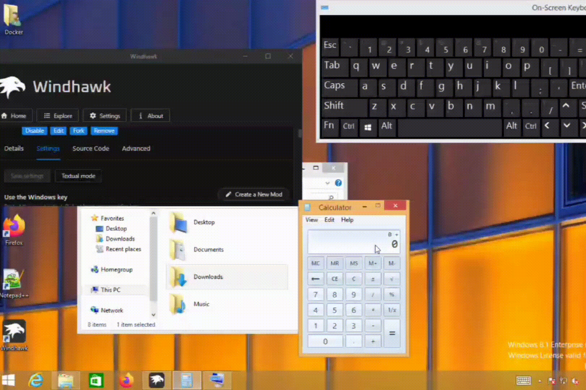
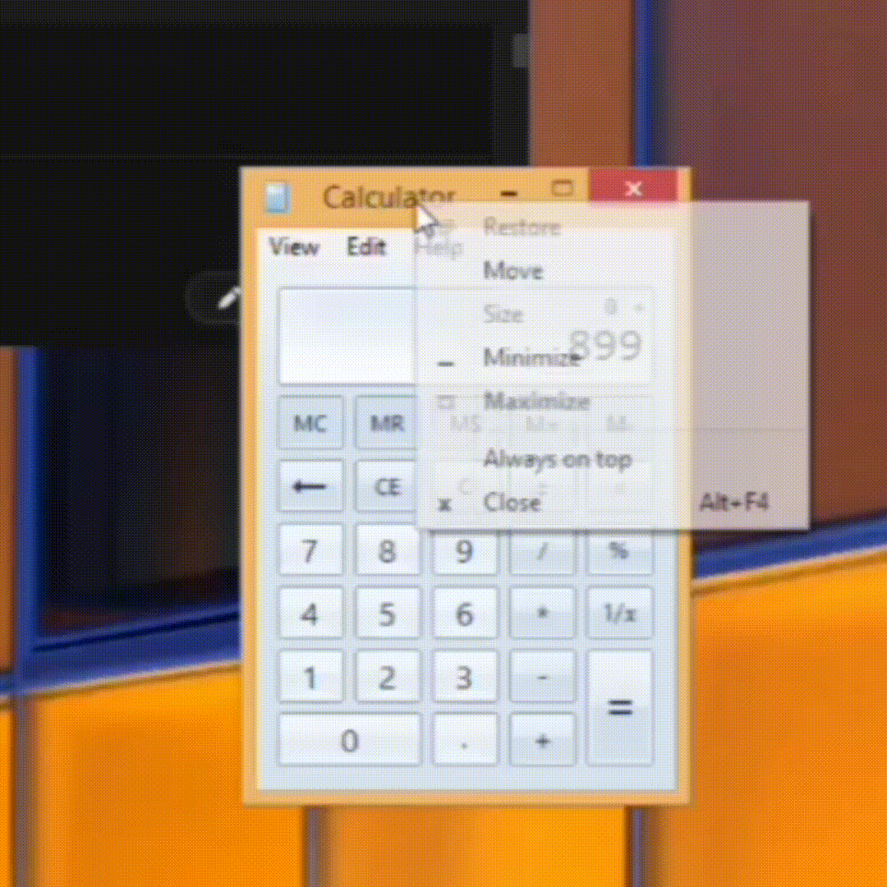
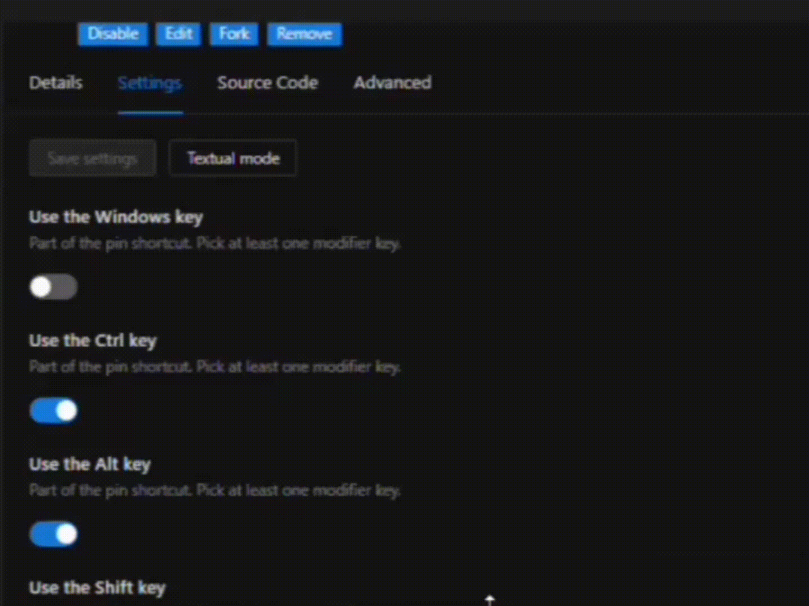

# Always On Top Windows

## اللغات: العربية - [English](https://github.com/AhmedAwad7/Always-On-Top-Windows-Windhawk-Mod-/blob/main/README.md)

اضغط على **`Ctrl+Alt+T`** (افتراضيًا) لتثبيت/إلغاء تثبيت النافذة النشطة فوق جميع النوافذ الأخرى.

تساعدك هذه الإضافة على إنجاز مهام متعددة من خلال تثبيت النوافذ المهمة بحيث تبقى مرئية دائمًا.

**الميزات:**
- 🔊 تنبيهات صوتية للإشارة إلى التثبيت/إلغاء التثبيت، مع إمكانية تخصيصها أو تعطيلها.
- 🖥️ نص عائم يظهر في أسفل منتصف الشاشة، أعلى شريط المهام، للإشارة إلى تثبيت/إلغاء تثبيت النافذة.
- 🟦 إطار مميز حول كل نافذة مثبتة. يتبع هذا الإطار النافذة عند تحريكها أو تغيير حجمها أو تصغيرها، ويستخدم لون تمييز ويندوز الخاص بك، أو لونًا من اختيارك، أو تدرجًا لونيًا. يمكن تقريب الزوايا لتتناسب مع النافذة.

- 👁️ اختصارات الشفافية: `Ctrl+Alt+(+)` و`Ctrl+Alt+(-)` تجعل النافذة المثبتة أكثر أو أقل شفافية، بخطوات متدرجة.
- ⌨️ يمكن تغيير الاختصار من الإعدادات (Win، Ctrl، Alt، Shift، وأي مفتاح آخر).
- 🚫 قائمة التطبيقات المستثناة، وخيار عدم الاستجابة أثناء تشغيل لعبة بملء الشاشة.
- 📌 إذا ألغى نظام ويندوز خاصية "دائمًا في المقدمة"، يعيدها التعديل.
- 🖱️ خيار "دائمًا في المقدمة" في القائمة التي تظهر عند النقر بزر الفأرة الأيمن على شريط عنوان النافذة.

- ⚙️ إمكانية تخصيص ما تريد من خلال قائمة إعدادات شاملة.

- ⚡ اختصار قائم على الأحداث (`RegisterHotKey`) بدون استطلاع مستمر.

- 🧹 خفيف الوزن: يعمل في عملية `windhawk.exe` مخصصة.

- ℹ️ لا يمكن تثبيت نوافذ التطبيقات التي تعمل كمسؤول، إلا إذا كان برنامج Windhawk المحمول يعمل كمسؤول.

**متطلبات النظام:**

- 📀 ويندوز 8 / 8.1 / 10 / 11

- 📊 تطبيق Windhawk (يُفضل أحدث إصدار)

## المساهمة:
- نرحب بالمساهمين! يمكنك فتح issues أو pull request على GitHub. ---
## التحميل:
- [يمكنك تحميل المود من موقع Windhawk mods هنا.](https://windhawk.net/mods/always-on-top) 
