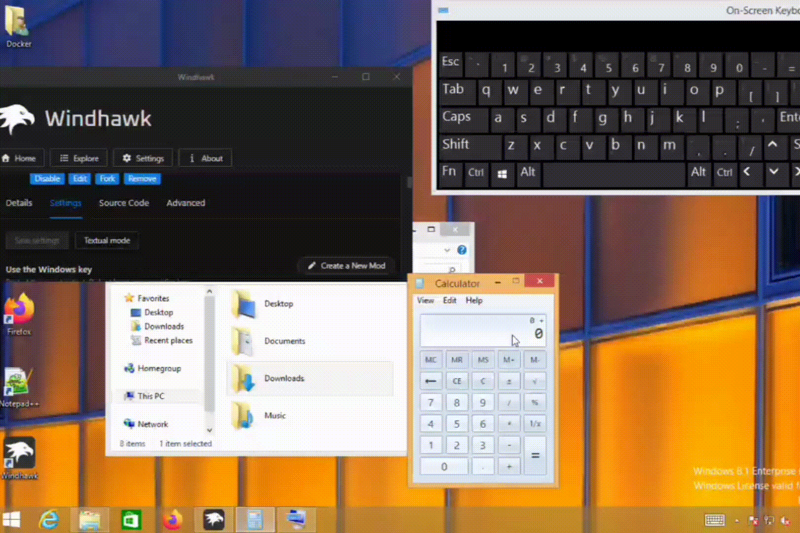
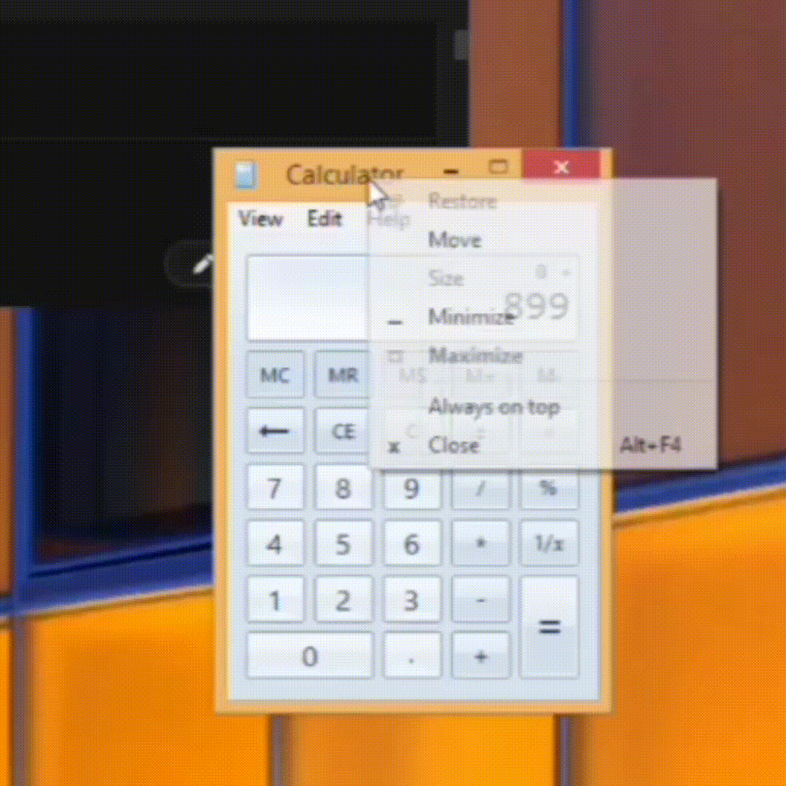
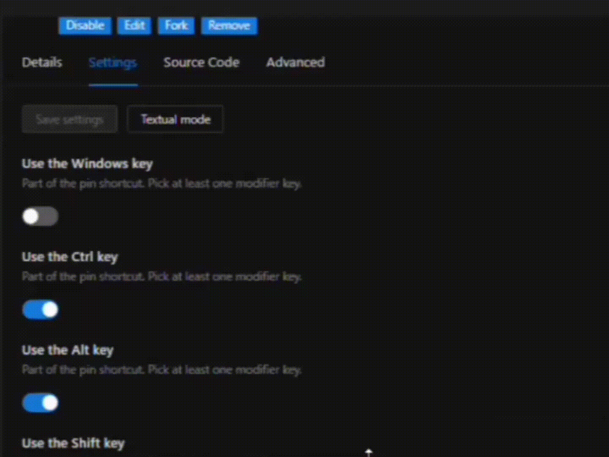

# Always On Top Windows

## Languagh: English - [Arabic](https://github.com/AhmedAwad7/Always-On-Top-Windows-Windhawk-Mod-/blob/main/README-AR.md)

Press **`Ctrl+Alt+T`** (Deafult) to pin/unpin the active window on top of all other windows.

This mod helps you multitask by pinning important windows so they always remain visible.

**Features:**
- 🔊 Audio notifications to indicate pinning/unpinning, with the ability to customize or disable them.
- 🖥️ A floating text displayed at the bottom center of the screen, above the taskbar, to indicate pinning/unpinning.
- 🟦 A highlight border around each pinned window. It follows the window when it moves, resizes or is minimised, and uses your Windows accent color, one color of your choice or a gradient. Corners can be rounded to match the window.

- 👁️ Opacity shortcuts: `Ctrl+Alt+(+)` and `Ctrl+Alt+(-)` make a pinned window more or less see-through, in steps.
- ⌨️ The shortcut can be changed in the settings (Win, Ctrl, Alt, Shift and any key).
- 🚫 An excluded apps list, and an option to not react while a full-screen game runs.
- 📌 If Windows drops the always-on-top state, the mod puts it back.
- 🖱️ An optional "Always on top" entry in the menu you get when you right-click a window's title bar.

- ⚙️ The ability to customize what you want with an extensive settings menu.

- ⚡ Event-based shortcut (`RegisterHotKey`) with no continuous polling.
- 🧹 Lightweight: Runs in a dedicated `windhawk.exe` process.
- ℹ️ Windows of apps that run as administrator cannot be pinned, unless portable Windhawk runs as administrator.

**System Requirements:**
- 📀 Windows 8 \ 8.1 \ 10 \ 11
- 📊 Windhawk application (latest version preferred)

## Contributing:
  - Contributors are welcome! You can open Issues or Pull Requests on GitHub.
---
## Download: 
- [You can download the mod from the Windhawk mods here.](https://windhawk.net/mods/always-on-top)
